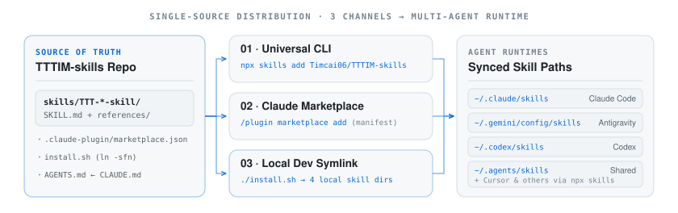

<p align="center">
  <picture>
    <source media="(prefers-color-scheme: dark)" srcset="./assets/readme/hero-dark.svg">
    <source media="(prefers-color-scheme: light)" srcset="./assets/readme/hero-light.svg">
    
  </picture>
</p>

<p align="center">
  <a href="./README.md"><kbd>中文 ↗</kbd></a> · <kbd>English</kbd>
</p>

<p align="center">
  
  
  
  
  
</p>

<p align="center">
  <b>Timcai06's personal AI Agent skills repository — authored once, distributed everywhere.</b><br>
  <sub>Built on the open <a href="https://agentskills.io">agentskills.io</a> specification and shipped via universal CLI, Claude Code Marketplace, and local symlinks.</sub>
</p>

<p align="center">
  <a href="#overview"><kbd>Architecture ↓</kbd></a>
  <a href="#quickstart"><kbd>Quick start ↓</kbd></a>
  <a href="#modules"><kbd>Skill catalog ↓</kbd></a>
  <a href="#status"><kbd>Boundaries ↓</kbd></a>
  <a href="./AGENTS.md"><kbd>Authoring guide ↗</kbd></a>
</p>

<br>

<h1 id="overview" align="center"><sub><samp>01</samp></sub><br>How single-source distribution works<br><sub>Architecture &amp; invariants</sub></h1>

<p align="center">
  <picture>
    <source media="(prefers-color-scheme: dark)" srcset="./assets/readme/flow-dark.svg">
    <source media="(prefers-color-scheme: light)" srcset="./assets/readme/flow-light.svg">
    
  </picture>
</p>

<p>Every skill lives strictly under <code>skills/TTT-&lt;Name&gt;-skill/</code> as the single source of truth. Downstream users pull skills via the universal <code>npx skills</code> CLI or the Claude Code plugin marketplace (backed by <code>.claude-plugin/marketplace.json</code>). For local iteration, running <code>./install.sh</code> once scans every subdirectory containing a <code>SKILL.md</code> and creates idempotent <code>ln -sfn</code> symlinks into four local agent directories, so edits take effect immediately across runtimes.</p>

- **Strict naming parity**: every skill directory follows `TTT-<Name>-skill` and matches both its `SKILL.md` frontmatter `name` and its entry in `.claude-plugin/marketplace.json`.
- **Zero-copy local sync**: `install.sh` gates on `SKILL.md` presence and links directories in place rather than copying files, eliminating cross-agent drift.
- **Lean instructions + sanitized references**: `SKILL.md` stays concise and actionable while long templates and specs live in `references/` with sensitive project details stripped.
- **Shared authoring contract**: [`AGENTS.md`](./AGENTS.md) defines the 5-step authoring checklist, with `CLAUDE.md` symlinked directly to it.

<br>

<h1 id="quickstart" align="center"><sub><samp>02</samp></sub><br>Quick start<br><sub>Install &amp; sync</sub></h1>

> Requirements: Node.js (`npx`) for universal CLI installs; macOS or Linux POSIX `bash` for local symlink sync.

```sh
# Option 1: Universal CLI — install all skills across agents (recommended)
npx skills add Timcai06/TTTIM-skills -g

# Option 2: Register as a Claude Code plugin marketplace
/plugin marketplace add Timcai06/TTTIM-skills

# Option 3: Clone locally and symlink into 4 local agent directories
git clone https://github.com/Timcai06/TTTIM-skills.git && cd TTTIM-skills && chmod +x install.sh && ./install.sh
```

<details>
<summary><kbd>More commands</kbd> &nbsp;Single-skill install &amp; local symlink verification</summary>

```sh
# Install an individual skill via universal CLI
npx skills add Timcai06/TTTIM-skills --skill TTT-MonoPDF-skill -g
npx skills add Timcai06/TTTIM-skills --skill TTT-Readme-skill -g

# Inspect the 4 local target directories managed by install.sh
ls -l ~/.agents/skills ~/.gemini/config/skills ~/.claude/skills ~/.codex/skills
```

</details>

<br>

<h1 id="modules" align="center"><sub><samp>03</samp></sub><br>Skills &amp; repository entrypoints<br><sub>Catalog &amp; structure</sub></h1>

| Skill / Module | Responsibility &amp; Artifacts | Entrypoint |
| :--- | :--- | :--- |
| `TTT-MonoPDF-skill` | Swiss-editorial monochrome Chinese/English executive PDFs (XeLaTeX `ctexart` + PingFang SC / Helvetica Neue + TikZ, with page-by-page PNG visual QA) | [`SKILL.md`](./skills/TTT-MonoPDF-skill/SKILL.md) · [`template.tex`](./skills/TTT-MonoPDF-skill/references/template.tex) |
| `TTT-Readme-skill` | Publication-grade editorial GitHub READMEs (project-adaptive dual-theme SVGs, numbered chapters, `<details>` disclosure, execution-path docs &amp; honest boundaries) | [`SKILL.md`](./skills/TTT-Readme-skill/SKILL.md) · [`svg-spec.md`](./skills/TTT-Readme-skill/references/svg-spec.md) |
| `install.sh` | Scans `skills/*/SKILL.md` and symlinks (`ln -sfn`) into 4 local agent skill directories | [`install.sh`](./install.sh) |
| `marketplace.json` | Claude Code marketplace manifest (`tttim-skills` plugin pointing to `./skills`) | [`marketplace.json`](./.claude-plugin/marketplace.json) |
| `AGENTS.md` | Directory conventions, naming boundaries, and 5-step authoring checklist (`CLAUDE.md` symlinks here) | [`AGENTS.md`](./AGENTS.md) |

<details>
<summary><kbd>Directory map</kbd> &nbsp;Full repository layout &amp; 5-step authoring workflow</summary>

```text
TTTIM-skills/
├── AGENTS.md                         # Authoring rules & 5-step checklist (CLAUDE.md -> AGENTS.md)
├── README.md / README.en.md          # Bilingual documentation (ZH / EN)
├── install.sh                        # One-command symlink sync for 4 local agent dirs
├── .claude-plugin/marketplace.json   # Claude Code plugin marketplace manifest
├── assets/readme/                    # Dual-theme SVG visuals for README
└── skills/
    ├── TTT-MonoPDF-skill/            # SKILL.md + references/template.tex
    └── TTT-Readme-skill/             # SKILL.md + references/{template-zh,svg-spec}.md
```

When adding or updating a skill, follow the 5-step checklist in [`AGENTS.md`](./AGENTS.md): scaffold `skills/TTT-<Name>-skill/` → document trigger and exclusion boundaries in `description` → update `.claude-plugin/marketplace.json` and this table → run `./install.sh` → verify cleanliness before committing.

</details>

<br>

<h1 id="status" align="center"><sub><samp>04</samp></sub><br>Status &amp; honest boundaries<br><sub>What works today &amp; known limits</sub></h1>

<details open>
<summary><kbd>Honest notes</kbd> &nbsp;Verified capabilities, distribution scope &amp; current limits</summary>

- **Working today**: 2 skills (`TTT-MonoPDF-skill`, `TTT-Readme-skill`) are authored to the `agentskills.io` layout; `./install.sh` 4-target symlinks and `.claude-plugin/marketplace.json` are in sync; both bilingual READMEs and dual-theme SVGs in this repository were generated and verified using `TTT-Readme-skill`.
- **Symlink script scope**: `install.sh` targets macOS / Linux POSIX shells (`bash` + `ln -sfn`) and writes only to `~/.agents/skills`, `~/.gemini/config/skills`, `~/.claude/skills`, and `~/.codex/skills`. For Cursor or other clients, install via the universal `npx skills` CLI; native Windows symlink support is not included.
- **Skill runtime prerequisites**: `TTT-MonoPDF-skill` requires a local XeLaTeX toolchain (MacTeX / TeX Live), `pdftoppm`, and macOS system fonts (`PingFang SC`, `Helvetica Neue`) to compile and visually inspect PDFs.
- **No CI validation yet**: consistency across directory names, `SKILL.md` frontmatter, and `marketplace.json` is currently checked manually/via agent against [`AGENTS.md`](./AGENTS.md) rather than enforced by GitHub Actions.

</details>

<hr>
<p align="center"><sub>TTTIM-skills &nbsp;·&nbsp; <a href="./README.md">中文</a> &nbsp;·&nbsp; <a href="./AGENTS.md">AGENTS.md</a></sub></p>
