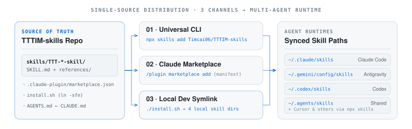

<p align="center">
  <picture>
    <source media="(prefers-color-scheme: dark)" srcset="./assets/readme/hero-dark.svg">
    <source media="(prefers-color-scheme: light)" srcset="./assets/readme/hero-light.svg">
    
  </picture>
</p>

<p align="center">
  <kbd>中文</kbd> · <a href="./README.en.md"><kbd>English ↗</kbd></a>
</p>

<p align="center">
  
  
  
  
  
</p>

<p align="center">
  <b>Timcai06 的个人 AI Agent Skills 单源仓库，一次维护、多端分发。</b><br>
  <sub>遵循 <a href="https://agentskills.io">agentskills.io</a> 开放规范，经由通用 CLI、Claude Code 插件市场与本机软链脚本同步至主流 Agent。</sub>
</p>

<p align="center">
  <a href="#overview"><kbd>分发架构 ↓</kbd></a>
  <a href="#quickstart"><kbd>快速安装 ↓</kbd></a>
  <a href="#modules"><kbd>技能目录 ↓</kbd></a>
  <a href="#status"><kbd>当前边界 ↓</kbd></a>
  <a href="./AGENTS.md"><kbd>开发规范 ↗</kbd></a>
</p>

<br>

<h1 id="overview" align="center"><sub><samp>01</samp></sub><br>一次维护如何分发到多端<br><sub>How single-source distribution works</sub></h1>

<p align="center">
  <picture>
    <source media="(prefers-color-scheme: dark)" srcset="./assets/readme/flow-dark.svg">
    <source media="(prefers-color-scheme: light)" srcset="./assets/readme/flow-light.svg">
    
  </picture>
</p>

<p>所有技能实体仅维护在仓库根目录的 <code>skills/TTT-&lt;Name&gt;-skill/</code> 下。新增或修订某项技能后，外部用户可通过 <code>npx skills</code> 或 Claude Code 插件市场（读取 <code>.claude-plugin/marketplace.json</code>）按需拉取；本机开发时只需执行一次 <code>./install.sh</code>，脚本扫描所有含 <code>SKILL.md</code> 的子目录并以 <code>ln -sfn</code> 幂等软链至 4 个本地 Agent 技能目录，此后每次编辑即时生效。</p>

- **命名强一致**：技能目录名固定为 `TTT-<Name>-skill`，必须与 `SKILL.md` frontmatter 的 `name` 及 `.claude-plugin/marketplace.json` 登记项完全一致。
- **单源零拷贝**：`install.sh` 以 `SKILL.md` 存在性为准入条件创建符号链接，不复制文件，避免多端版本漂移。
- **精炼主文档 + 脱敏参考**：`SKILL.md` 聚焦触发边界与执行步骤，长模板与规范沉淀在 `references/`，真实案例入库前脱敏。
- **统一协作规则**：根目录 [`AGENTS.md`](./AGENTS.md) 承载新增技能 5 步检查清单，`CLAUDE.md` 软链指向同一文件。

<br>

<h1 id="quickstart" align="center"><sub><samp>02</samp></sub><br>快速安装与同步<br><sub>Quick start</sub></h1>

> 环境要求：跨端 CLI 安装需 Node.js（`npx`）；本机软链同步需 macOS / Linux POSIX `bash` 环境。

```sh
# 方式 1：通用 CLI 安装全部技能（推荐，跨主流 Agent）
npx skills add Timcai06/TTTIM-skills -g

# 方式 2：在 Claude Code 中添加插件市场源
/plugin marketplace add Timcai06/TTTIM-skills

# 方式 3：本地克隆并一键软链至 4 个本机 Agent 目录（适合持续维护）
git clone https://github.com/Timcai06/TTTIM-skills.git && cd TTTIM-skills && chmod +x install.sh && ./install.sh
```

<details>
<summary><kbd>更多命令</kbd> &nbsp;单技能安装与本机软链核对</summary>

```sh
# 仅安装单个指定技能
npx skills add Timcai06/TTTIM-skills --skill TTT-MonoPDF-skill -g
npx skills add Timcai06/TTTIM-skills --skill TTT-Readme-skill -g

# 核对 install.sh 同步的 4 个本机目录软链状态
ls -l ~/.agents/skills ~/.gemini/config/skills ~/.claude/skills ~/.codex/skills
```

</details>

<br>

<h1 id="modules" align="center"><sub><samp>03</samp></sub><br>技能目录与仓库入口<br><sub>Skills &amp; repository entrypoints</sub></h1>

| 技能 / 模块 | 职责与核心产物 | 入口 |
| :--- | :--- | :--- |
| `TTT-MonoPDF-skill` | 极简黑白瑞士编辑风中英文汇报 PDF（XeLaTeX `ctexart` + PingFang SC / Helvetica Neue + TikZ，含逐页 PNG 视觉自查） | [`SKILL.md`](./skills/TTT-MonoPDF-skill/SKILL.md) · [`template.tex`](./skills/TTT-MonoPDF-skill/references/template.tex) |
| `TTT-Readme-skill` | 出版级编辑风 GitHub README（项目自适应明暗双主题 SVG、编号章节、`<details>` 渐进折叠、主链路架构与如实边界） | [`SKILL.md`](./skills/TTT-Readme-skill/SKILL.md) · [`svg-spec.md`](./skills/TTT-Readme-skill/references/svg-spec.md) |
| `install.sh` | 扫描 `skills/*/SKILL.md` 并以 `ln -sfn` 同步到 4 个本机 Agent 技能目录 | [`install.sh`](./install.sh) |
| `marketplace.json` | Claude Code 插件市场声明清单（插件名 `tttim-skills`，指向 `./skills`） | [`marketplace.json`](./.claude-plugin/marketplace.json) |
| `AGENTS.md` | 仓库目录约定、命名边界与新增/修改技能标准 5 步检查清单（`CLAUDE.md` 软链至此） | [`AGENTS.md`](./AGENTS.md) |

<details>
<summary><kbd>目录地图</kbd> &nbsp;查看完整仓库骨架与新增技能检查清单</summary>

```text
TTTIM-skills/
├── AGENTS.md                         # 开发规范与 5 步清单（CLAUDE.md 软链至此）
├── README.md / README.en.md          # 中英文双语说明
├── install.sh                        # 本机 4 端一键软链同步脚本
├── .claude-plugin/marketplace.json   # Claude Code 插件市场清单
├── assets/readme/                    # README 明暗双主题 SVG 资产
└── skills/
    ├── TTT-MonoPDF-skill/            # SKILL.md + references/template.tex
    └── TTT-Readme-skill/             # SKILL.md + references/{template-zh,svg-spec}.md
```

新增或修改技能时按 [`AGENTS.md`](./AGENTS.md) 执行 5 步：创建 `skills/TTT-<Name>-skill/` → 写清 `description` 触发与排除边界 → 同步更新 `.claude-plugin/marketplace.json` 与本表 → 运行 `./install.sh` 刷新本机软链 → 校验无临时文件后提交推送。

</details>

<br>

<h1 id="status" align="center"><sub><samp>04</samp></sub><br>当前状态与边界<br><sub>Status &amp; honest boundaries</sub></h1>

<details open>
<summary><kbd>如实说明</kbd> &nbsp;已验证能力、分发覆盖范围与已知限制</summary>

- **已跑通**：仓库现含 2 个可用技能（`TTT-MonoPDF-skill`、`TTT-Readme-skill`）；`./install.sh` 本机 4 目录软链与 `.claude-plugin/marketplace.json` 登记均已对齐；本仓库自身双语 README 与双主题 SVG 即由 `TTT-Readme-skill` 实测产出。
- **脚本覆盖边界**：`install.sh` 仅面向 macOS / Linux（依赖 `bash` 与 `ln -sfn`），固定同步 `~/.agents/skills`、`~/.gemini/config/skills`、`~/.claude/skills`、`~/.codex/skills` 4 个目录；Cursor 等其余客户端请通过通用 `npx skills` CLI 安装，暂未提供 Windows 原生同步脚本。
- **单技能运行前提**：`TTT-MonoPDF-skill` 依赖本机已安装 XeLaTeX（MacTeX / TeX Live）、`pdftoppm` 及 macOS 字体（PingFang SC / Helvetica Neue），非纯 Markdown 环境开箱即编。
- **尚未自动化**：目前未配置 GitHub Actions CI 自动校验目录名、`SKILL.md` frontmatter 与 `marketplace.json` 的一致性，当前依赖 `AGENTS.md` 5 步清单在提交前自检。

</details>

<hr>
<p align="center"><sub>TTTIM-skills &nbsp;·&nbsp; <a href="./README.en.md">English</a> &nbsp;·&nbsp; <a href="./AGENTS.md">AGENTS.md</a></sub></p>
